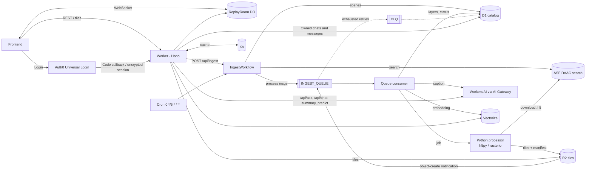

# backend

## Purpose
The Earth Replay backend for NASA Space Apps 2026, "Dancing with the SARs". It ingests real NISAR radar scenes from ASF DAAC, catalogs them, serves precomputed tiles, writes AI explanations of surface change, and syncs shared replay sessions, all through a Cloudflare-based API. The frontend is owned separately.

Scope summary (the source of truth is [CLAUDE.md](CLAUDE.md)):
- **In scope:** NISAR search and download (ASF DAAC); processing scenes into tiles/COGs in R2; a catalog of events, scenes, polarizations and dates; a REST and tile API; AI captions with semantic search; WebSocket replay rooms; cron polling; and heavy, justified use of Cloudflare.
- **In scope:** Auth0-managed browser login/logout and one-hour sessions protecting ingest and AI writes; public browsing remains available.
- **In scope:** Persistent D1 chats/messages owned by Auth0 subjects, with authenticated history retrieval and optional conversational `/api/ask` persistence.
- **Out of scope:** the frontend, synthetic data presented as observations, locally managed user accounts or payments, custom SAR algorithms, and anything that can't be demoed by Nov 15, 2026.

## Contents
| Path | Description |
|---|---|
| [cloudefare/](cloudefare/SPEC.md) | The Cloudflare Worker: API, Workflow, Queues, Durable Object, AI and D1 schema. |
| `main.js` | Backend entry point: re-exports the Worker (`fetch`/`queue`/`scheduled`), `IngestWorkflow` and `ReplayRoom` from `cloudefare/`. Wrangler still deploys `cloudefare/worker.js` directly. |
| `CLAUDE.md` | Project scope and working rules. |
| `AGENTS.md` | Backend-scoped Codex instructions that refer to CLAUDE.md. |
| `prompt.md` | A pointer to Cloudflare's agent-setup prompt. |
| `.gitignore` | Ignores `node_modules`, `.wrangler`, `.dev.vars` and build output. |

## Architecture

NISAR HDF5 is never parsed in the Worker. The processor writes tiles and a manifest to R2. An R2 event notification then tells the Worker that a scene is ready.

## Interfaces
The HTTP API contract is listed in [CLAUDE.md](CLAUDE.md), and full payloads are in [cloudefare/SPEC.md](cloudefare/SPEC.md).

## Dependencies
Cloudflare account resources (see the setup commands in `cloudefare/SPEC.md`), ASF DAAC, and an Earthdata Login token for the processor.

## Tests
`cd cloudefare && npm test` (Vitest + `@cloudflare/vitest-plugin`).

## Status
Persistent chat create/list/detail/message endpoints and optional `/api/ask` conversation persistence are implemented locally. Ownership comes from verified Auth0 subjects; history survives session expiry. See [cloudefare/CHAT_STORAGE.md](cloudefare/CHAT_STORAGE.md). Production migration/deployment remain separate.

Auth0 login is implemented in source with tests and a configured Auth0 application. Local credentials are saved in an ignored file. This auth change is not deployed; production setup and frontend integration are documented in [cloudefare/AUTH0.md](cloudefare/AUTH0.md).

The Worker is deployed with supplementary NASA discovery adapters for FIRMS, GPM, SMAP, HLS, GEOS-FP, NASADEM and GRACE/GRACE-FO. These expose bounded metadata/file references and FIRMS detections, not raster analysis or predictions. Production resource IDs, secrets, AI Gateway, Vectorize filter and R2 manifest notifications are configured. Endpoint contracts, live verification and limitations are in [cloudefare/ENDPOINT_REFERENCE.md](cloudefare/ENDPOINT_REFERENCE.md). The external Python processor (local or Container) remains absent; real scene jobs stop at `awaiting_processor`.

## Changelog
- 2026-11-14 - Added persistent Auth0-owned chats, message pagination and atomic AI turns, and moved request session policy into sessionManger.js.
- 2026-11-14 - Added Auth0 login/logout/profile and encrypted sessions; require login for ingest and AI writes while retaining public browsing.
- 2026-11-14 - Removed the unshipped processor work at user request; existing dataset discovery and deployed API remain unchanged.
- 2026-11-14 - Deployed and verified the Worker via Cloudflare MCP; linked production endpoint documentation and recorded the remaining processor gap.
- 2026-11-14 - Scoped Codex instructions to the backend with AGENTS.md referencing CLAUDE.md.
- 2026-11-14 - Added regional NASA dataset discovery and partial-result context API; documented live provider checks and remaining processing requirements.
- 2026-11-14 - Added the multi-agent AI chat, per-event summaries and predictive analysis to the Worker (see cloudefare/AI/SPEC.md). Needs `npm run db:migrate:remote` for migration 0002.
- 2026-11-14 - Finished main.js as the backend entry point re-exporting the Worker, Workflow and Durable Object.
- 2026-11-14 - Added event discovery (USGS), NISAR preview and geocoding routes to the Worker.
- 2026-11-14 - Created the root spec, the architecture diagram and .gitignore, and added the cloudefare Worker.
