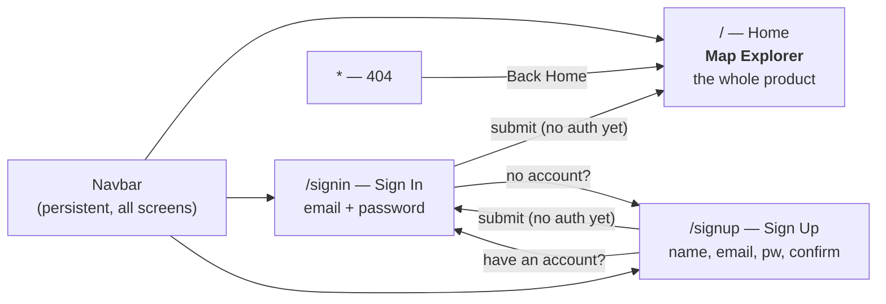
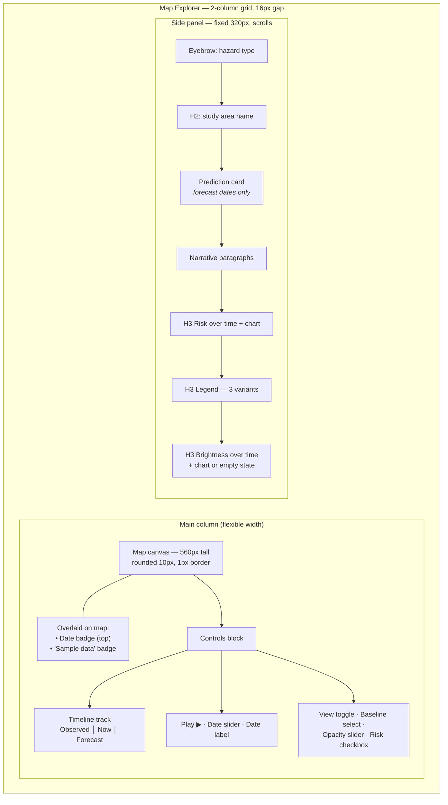
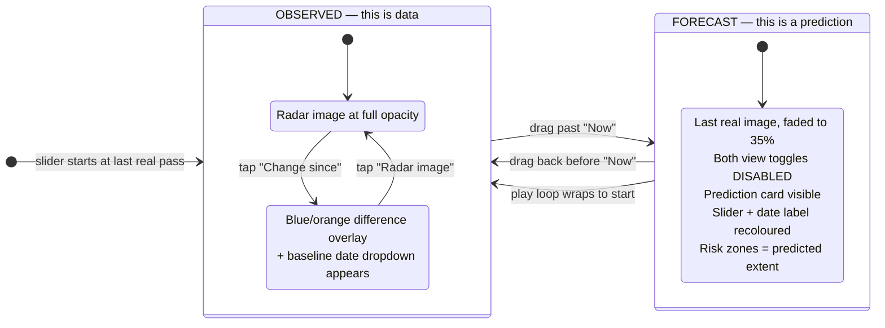
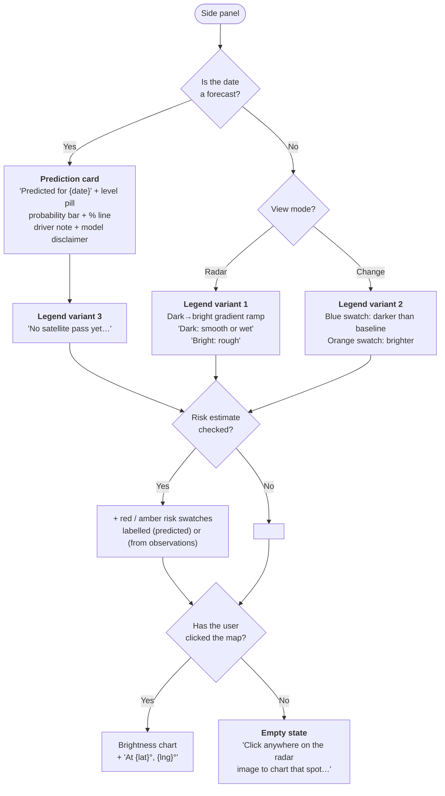

# Design Handoff — SpaceApp

**To:** Figma AI / design
**From:** engineering
**Status:** working prototype exists, needs a design pass before judging

---

## 1. What this is

A NASA Space Apps entry. It shows satellite radar (NISAR) observations of an
active volcano — the Aso caldera in Kumamoto Prefecture, Japan — across
successive passes, then continues past today into a model's forecast of
eruption risk.

The organising idea is **one timeline slider that runs from measured past into
predicted future.** Everything left of a "Now" mark is data a satellite
actually collected. Everything right of it is a model's guess.

The product is one screen. The other three screens exist but are scaffolding.

---

## 2. The one rule that cannot be broken

> **A prediction must never be able to look like a measurement.**

This is not a styling preference. The app shows eruption risk; a viewer who
mistakes a forecast for an observation has been actively misled. Every design
decision is subordinate to this.

The build currently enforces it with five simultaneous signals the moment the
slider crosses "Now":

1. The radar image drops to 35% opacity (it is now just ground context, not
   evidence).
2. Both view-mode toggles disable.
3. The slider thumb and date label recolour.
4. A "Forecast" tag appears on the date badge.
5. A prediction card appears in the side panel, carrying an explicit
   disclaimer: *"Placeholder forecast. Swap in your model output."*

**Please keep at least this much redundancy.** Colour alone is not enough —
some judges will view this on a projector, and some are colourblind. If you
can make the distinction clearer than we have, that is the single most
valuable thing you can do for this project.

---

## 3. Screens

| Screen | Priority | Note |
| --- | --- | --- |
| **Map Explorer** (`/`) | **All of it** | This is what gets demoed and judged. |
| Sign In / Sign Up | Low | Forms work but authenticate nothing — the submit handlers are stubs. Style them; do not design flows around sessions, password reset or OAuth, because none exist. |
| 404 | Lowest | Currently a bare "404" and a link home. |

---

## 4. Map Explorer anatomy

### Current measurements

| Property | Value |
| --- | --- |
| Grid | `minmax(0, 1fr)` + `320px`, 16px gap |
| Map height | 560px desktop, 420px below 900px |
| Panel | 320px wide, max 690px tall, scrolls internally |
| Breakpoint | 900px — collapses to a single column |
| Base type | 0.95rem / 1.5 line height, `system-ui` |
| Radii | 10px cards, 8px buttons, 999px pills |

Treat these as the current state, not a constraint. The layout is CSS Grid and
is cheap to change.

---

## 5. States to draw

This is the behaviour that makes the project work. Please produce variants for
each branch.

### Side panel variants

---

## 6. Component inventory

| Component | States needed |
| --- | --- |
| **Timeline track** | Split bar: "Observed" portion, "Forecast" portion, "Now" divider. Current split is 6 observed : 4 forecast. Must also work with zero forecast dates (divider hides entirely). |
| **Date slider** | Default, dragging, focused, forecast-position (recoloured). |
| **Play button** | Play ▶, Pause ❚❚, hover, focus. |
| **View toggle** | 2-segment control: Radar image / Change since. Each needs default, active, **disabled** (both disable on forecast dates). |
| **Baseline dropdown** | Only present in Change mode. Shows 6 dates. |
| **Opacity slider** | Inline, labelled. |
| **Risk checkbox** | Checked / unchecked. |
| **Date badge** | Over the map. Two variants: plain, and with a "Forecast" tag. |
| **Sample data badge** | Over the map. Shows while data is fake — it is fake right now. |
| **Prediction card** | Three level pills: HIGH / MEDIUM / LOW. Probability bar at e.g. 44%, 62%, 81%. Plus driver note and disclaimer line. |
| **Risk chart** | Inline SVG, 300×130. Solid line over observed, dashed over forecast, bridged at "Now". Active dot on the current date. Shaded "future" region. |
| **Brightness chart** | Same frame. Plotted state and empty state. Forecast half shaded and labelled "no data yet". |
| **Legend** | Three variants (see diagram above) plus the optional risk-zone swatches. |
| **Error line** | "Could not load /data/…" — shown when an image is missing. |
| **Auth form** | Default, inline error ("Passwords do not match"), submit button. |

---

## 7. Current palette

Defined as CSS custom properties scoped to `.sx` in `Frontend/src/MapView.css`,
so they are straightforward to replace wholesale.

| Token | Hex | Used for |
| --- | --- | --- |
| `--sx-surface` | `#2a1428` | Panel and control surfaces |
| `--sx-border` | `#3d1f3a` | All borders |
| `--sx-text` | `#EBF5EE` | Primary text |
| `--sx-muted` | `#D8BFAA` | Secondary text, notes |
| `--sx-accent` | `#542344` | Buttons |
| `--sx-highlight` | `#BFD1E5` | Active states, links |
| page background | `#1e0f1c` | Set in `App.css` |

**Semantic colours — these carry meaning, do not reassign them casually:**

| Hex | Means |
| --- | --- |
| `#e5484d` red | High risk zone (ballistics, pyroclastic flow) |
| `#f5a524` amber | Medium risk zone (ashfall) |
| `#2b83ff` blue | Ground got *darker* than baseline — often new water or fresh ash |
| `#ff8c28` orange | Ground got *brighter* — water receded, or rougher surface |
| `#ff6b6b` | Error text |

Note the amber/orange pair is uncomfortably close and sits on the same map at
the same time. Worth fixing.

The palette is dark-only. There is no light mode and we do not need one.

---

## 8. What we are asking for

In priority order:

1. **Make the observed/forecast split unmissable.** See §2. This is the ask.
2. **Lay out the Map Explorer properly.** The map currently sits inside a
   centred container with 4rem padding, so it does not use the screen. It
   probably wants to be full-bleed with the panel docked.
3. **Design the control bar.** It is currently a plain row of browser-default
   inputs and reads as a prototype.
4. **Tidy the side panel.** Lots of small type, three chart-ish things, and a
   legend that changes shape. It needs a clearer hierarchy.
5. **Give the two charts a consistent treatment** — they share a frame but
   were drawn independently.
6. Style the auth screens and 404 to match.

Useful to receive: desktop and mobile frames for the Map Explorer in both
observed and forecast states, the component variants from §6, and a token set
we can map onto the CSS custom properties.

---

## 9. Constraints worth knowing before you design

| Thing | Constraint |
| --- | --- |
| **The map itself** | MapLibre GL. We control overlay opacity, fill/line colour and opacity, and the basemap style URL. We do **not** hand-draw the map. Basemap is OpenFreeMap "Liberty" — swappable for another style URL, including a dark one. |
| **The radar imagery** | Greyscale PNGs laid over the map as a flat, north-up rectangle. We cannot restyle them beyond opacity. They are currently **synthetic placeholders**. |
| **Map orientation** | Locked to 2D. No rotation, no tilt, by design — the overlay is a flat rectangle. Please do not design a 3D or tilted view. |
| **Charts** | Hand-written inline SVG, 300×130, no chart library. Anything you draw we draw by hand, so favour simple marks over dense ones. |
| **Risk zones** | Concentric irregular rings around the vent, as filled polygons with a stroke. Only two categories exist: high and medium. |
| **Icons** | There are none. The play/pause button is literally the characters ▶ and ❚❚. An icon set would be welcome. |
| **Type** | `system-ui` everywhere. No webfont is loaded — picking one is open. |
| **Data volume** | 6 observed dates, 4 forecast dates, 12 days apart. Design the timeline for ~10 stops, not 100. |

---

## 10. Honest status

- All imagery, risk numbers and forecast probabilities are **placeholder**,
  generated by a Python script. The geography, the bounding box and the 12-day
  satellite cycle are real.
- There is no backend. The auth forms log to the console.
- The "Sample data" badge is on and stays on until real data lands.

Do not design anything that implies the numbers are validated.

---

## 11. Reference

| Want | Look at |
| --- | --- |
| Diagram sources | `mermaid.js` in this folder |
| Repo-wide context | `CLAUDE.md`, `spec.md` |
| The map component | `Frontend/src/mapview.jsx` |
| All current styling | `Frontend/src/MapView.css` (map), `Frontend/src/App.css` (chrome) |
| Copy currently in the panel | `Frontend/src/studyArea.js` — the `story` array |

To run it: `cd Frontend && npm install && npm run dev`.
