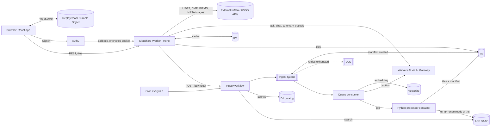

# Handoff — Earth Replay

**NASA Space Apps 2026 · Challenge: "Dancing with the SARs"**
**Last updated:** 2026-11-15

This document is the starting point for anyone picking up the project. It covers
what the product is, why it exists, how it is built, why each piece of the stack
was chosen, and what state it is in now. Deeper detail lives in the per-folder
`SPEC.md` / `spec.md` files linked at the end.

---

## 1. In one sentence

Earth Replay lets anyone pick a place on Earth and **replay how its surface has
changed**, using real radar observations from the NASA-ISRO **NISAR** satellite,
and then see **clearly labelled, modelled outlooks** of what may come next,
with AI specialists explaining what the change could mean.

---

## 2. The problem

NISAR is a radar (SAR) satellite launched in 2025 by NASA and ISRO. It images
nearly all of Earth's land and ice every 12 days, day or night, through clouds.
That makes it ideal for tracking earthquakes, floods, landslides, glacier
movement, crop and forest change, and soil moisture.

But the data is hard to use:

- **It is huge and specialised.** Each scene is a 1–2 GB HDF5 file in radar
  geometry, behind an Earthdata login at the Alaska Satellite Facility (ASF).
- **It is not visual.** Raw radar backscatter, interferograms and offsets mean
  nothing to a non-expert without processing and colouring.
- **It lacks context.** A change in a radar image is only useful when you know
  what happened there (an earthquake, rainfall, a fire) and what it might mean.
- **Prediction is easily confused with observation.** Hazard tools that blend
  the two mislead people at exactly the moment it matters.

The challenge brief asks for an app that tracks and visualises one or more types
of surface change using NISAR data.

---

## 3. The idea

**One timeline that runs from measured past into modelled future.**

- Left of a **"Now"** mark: real satellite passes, 12 days apart, shown as
  radar images or as "change since" a chosen baseline.
- Right of "Now": model output (trend projections, seismic outlooks), shown in a
  deliberately different visual language.
- Around the map: an evidence panel with charts, supplementary NASA datasets for
  the same area, news-style imagery, and AI specialists you can question.

### The rule that governs everything

> **A prediction must never be able to look like a measurement.**

This is a correctness requirement, not a style choice. On every forecast date the
UI changes in several redundant ways at once: the radar image fades to a fixed
35% opacity, the view-mode toggles disable, the slider and date label change
colour **and** shape/wording ("FORECAST"), a prediction card with an explicit
disclaimer appears, risk extents turn dashed, and charts shade the future region.
The backend enforces the same rule: every modelled response carries
`modeled: true` and a disclaimer, every AI response carries `aiGenerated: true`,
and AI prompts are told to phrase drivers as hypotheses.

Any change that blurs this line is wrong, however good it looks.

---

## 4. Who it is for

| User | What they get |
| --- | --- |
| **Curious public / judges** | Signed-out browsing of Japan, plus seven bundled sample scenarios (volcano, earthquake, flood, landslide, glacier, drought, wildfire) that work with no backend data. |
| **Students, journalists, local responders** | Sign in, click anywhere, find NISAR scenes and recent M4.5+ earthquakes nearby, start tracking an area, replay it, and ask AI specialists what they are seeing. |
| **Researchers / developers** | A documented open REST + tile API over a NISAR catalog, plus regional NASA dataset discovery. |

---

## 5. What the product does

### Map explorer (home)

- A **source switch**: **NISAR data** (live catalog) or **Sample data** (bundled demo).
- **Sample mode**: seven hazard scenarios. Each has observed radar passes, a
  "Change since" view (blue = darker than baseline, orange = brighter, computed
  in the browser), risk extents, a risk-over-time chart, a click-to-chart
  brightness series, and forecast dates with a prediction card.
- **NISAR mode**: shows processed tile layers when they exist, otherwise ASF's
  real preview image for each catalogued scene, placed on its real footprint.
  - Signed out: Japan highlighted, the rest of the world dimmed, Japan's events only.
  - Signed in: click anywhere → the app searches a 1° box for NISAR scenes
    (last 90 days), nearby M4.5+ earthquakes and other NASA datasets, lists
    catalogued events covering the spot, and lets you **start tracking** the
    area or an earthquake.
- **Replay**: any event with two or more scene dates plays from its first date,
  at 0.5×–4× speed, with loop. For earthquakes it shows days before/after the
  quake. Signed-in users can replay a search result or a nearby past quake
  without tracking it.
- **Outlook**: shades grid cells by the chance of at least one M4.5+ earthquake
  in the next 7, 30 or 90 days, from the past year's USGS catalog (Poisson rate).
  An AI model words scenario text from those numbers. It is labelled as modelled
  and never predicts a specific earthquake.

### Events page (`/events`, `/events/:id`)

A date-range catalog of tracked events. Each event shows scene metadata,
regional NASA context (rainfall, soil moisture, fires, terrain, groundwater), an
AI briefing, USGS impact maps and related NASA photos, and a signed-in
question box backed by AI specialists.

### AI layer

- **Captions**: when a scene is processed, an AI caption hypothesises the
  physical driver of the change. Captions are embedded for semantic search.
- **Ask**: grounded Q&A over an event's captions, scenes and regional context.
  Signed-in conversations are saved privately and survive logout/login.
- **Specialist chat**: seismologist, hydrologist, ecologist, glaciologist,
  soil scientist, forecaster and coordinator. A question is routed to one
  specialist, who can consult up to two others.
- **Summary**: a per-event briefing written by the event type's specialist.
- **Predict**: a deterministic trend projection (least-squares line with a
  confidence band) over stats from processed scenes. AI only narrates the
  computed numbers. Confidence is capped at "moderate".

### Shared replay rooms

A WebSocket room code keeps several viewers' playback (frame, play/pause,
speed, layer) in sync, for classrooms or briefings.

---

## 6. Repository layout

```
spaceapp/
├── Frontend/            React + Vite app — the main user-facing product
├── workstation/         Standalone no-build "telemetry workstation" UI (alternate design, sample data)
├── backend/
│   └── cloudefare/      Cloudflare Worker API (the whole backend)
│       ├── AI/          Captions, ask, specialist agents, summary, forecast
│       ├── migrations/  D1 SQL schema
│       ├── processor/   Python NISAR → map tiles service (Cloudflare Container)
│       ├── bench/       Developer benchmark of chat models
│       └── tests/       Vitest suites + fixtures
├── README.md            Overview and run notes
├── setup.md             Step-by-step local setup (PowerShell)
├── design-handoff.md    Earlier design brief for the map explorer UI
└── handoff.md           This file
```

The folder is spelled `cloudefare` (not `cloudflare`). Keep it that way; paths in
scripts and docs depend on it.

---

## 7. Architecture



**Ingest flow, step by step**

1. A signed-in user starts tracking an area (or a USGS earthquake), or the
   6-hourly cron re-polls a watched event.
2. A durable **Workflow** searches ASF for NISAR scenes, catalogs them in **D1**,
   and enqueues one message per scene.
3. The **queue consumer** sends each scene to the **Python processor**, which
   reads only the needed bytes of the HDF5 file over HTTP range requests, crops
   to the area, reprojects to Web Mercator, colours it and cuts PNG tiles into
   **R2**, writing a manifest last.
4. R2's object-created notification puts the manifest back on the queue. The
   consumer registers the layers, marks the scene `ready`, writes an AI caption
   and stores its embedding in **Vectorize**.
5. The frontend reads the catalog and tiles from the Worker. Failures retry with
   backoff and end in a dead-letter queue that marks the scene `failed` with a reason.

---

## 8. Tech stack, and what each choice solves

### Frontend (`Frontend/`)

| Technology | Why it is here / what it solves |
| --- | --- |
| **React 19 + React Router 7** | Component model for a stateful map UI (timeline, modes, panels); client routing for `/`, `/events`, sign-in pages. |
| **Vite 8** | Fast dev server with hot reload; its proxy forwards `/api`, `/auth`, `/tiles` and WebSockets to the Worker so the app and API share one origin in development (needed for Auth0 cookies). |
| **MapLibre GL 6** | Open-source WebGL map with no API key. Handles raster image overlays, XYZ tile layers and GeoJSON risk polygons. Rotation and pitch are disabled on purpose: radar overlays are north-up rectangles. |
| **OpenFreeMap basemap** | Free vector basemap, no key, no secrets in the frontend. |
| **Canvas 2D `getImageData`** | In-browser change detection: images are block-averaged 4×4 (to suppress radar speckle) and differenced against a baseline. No server round trip. |
| **Hand-written inline SVG charts** | Small, exact control over the observed-vs-forecast styling (solid vs dashed, shaded future) without a chart library. |
| **Plain JSX + CSS, oxlint** | Minimal tooling for a hackathon timeline. No TypeScript, no CSS framework, no state library. |
| **Python (numpy, Pillow) scripts** | Generate the bundled sample radar PNGs and hazard GeoJSON for the seven demo scenarios. |

### Backend (`backend/cloudefare/`) — Cloudflare-native

The brief rewards heavy, justified use of a platform. Each Cloudflare service
maps to one concrete job:

| Service | What it solves |
| --- | --- |
| **Workers + Hono** | The whole REST/tile API at the edge, low latency worldwide, no servers to run. Hono gives clean routing and middleware. Also serves the built frontend as static assets, so app and API share one origin in production. |
| **Workflows** | Durable multi-step ingest (search → catalog → enqueue → finalize) with per-step retries. A long ASF search survives restarts instead of timing out a request. |
| **Queues + Dead-letter queue** | Per-scene processing with backoff; one bad scene cannot stall an ingest, and failures are recorded instead of lost. |
| **Containers (Python)** | NISAR HDF5 cannot be parsed inside a Worker (memory/CPU limits). A container runs h5py/rasterio to turn scenes into tiles. |
| **R2** | Cheap object storage for map tiles and manifests, with no egress fees. Its event notifications tell the pipeline when a scene is ready. |
| **D1 (SQLite)** | The catalog: events, scenes, layers, captions, chats, messages, regional context. Relational queries with SQL migrations. |
| **KV** | Short-lived caches (event list 60 s, AI answers 1 h, USGS 10 min, media 6 h) to cut latency and upstream load. |
| **Durable Objects (SQLite, hibernating WebSockets)** | Shared replay rooms: one authoritative playback state per room code, synced to every viewer. |
| **Workers AI** | Hosted LLMs (Llama 3.3 70B, Mistral Small 3.1) and an embedding model (BGE base, 768-dim) without managing GPUs. |
| **AI Gateway** | One point for caching, logging and rate-limiting model calls, plus per-use-case routing to Groq or Google AI Studio models with fallback chains. |
| **Vectorize** | Semantic search over scene captions, filtered by event, so answers cite the most relevant scenes. |
| **Cron Triggers** | Every 6 hours, re-polls ASF for newly published scenes over watched events. NISAR data is still being released through 2026. |

### Other services

| Service | What it solves |
| --- | --- |
| **Auth0** | Managed login (authorization code + PKCE) with encrypted HttpOnly session cookies. No locally stored passwords. Protects ingest and AI writes; browsing stays public. |
| **ASF DAAC search API** | Finding NISAR scenes (GCOV, GUNW, GOFF, SME2) by area and date. |
| **USGS earthquake API** | Earthquake discovery, the seismic outlook's base rates, and ShakeMap/PAGER impact maps. |
| **NASA CMR, GEOS-FP, FIRMS** | Supplementary context for the same area: GPM rainfall, SMAP soil moisture, HLS optical, NASADEM terrain, GRACE groundwater, GEOS forecasts, FIRMS active fires. |
| **NASA Image and Video Library** | Related photos for events. |
| **Google Geocoding** (optional) | Place name → area of interest. |

### Testing

- Backend: **Vitest** inside workerd via `@cloudflare/vitest-plugin`, with local
  D1/R2/KV/Queues/Durable Objects/Workflows and mocked external APIs. Recent
  runs: 266 tests passing.
- Processor: **pytest**.
- Frontend: `npm run lint` and `npm run build`, plus manual browser checks. No
  automated UI tests.

---

## 9. NISAR products used

| Product | What it shows | Used for event type |
| --- | --- | --- |
| **GCOV** | Radar backscatter (surface roughness / wetness) | Default: flood, wetland, forest, crop, other |
| **GUNW** | Interferogram (ground deformation, coherence) | Earthquake |
| **GOFF** | Pixel offsets (horizontal movement) | Glacier |
| **SME2** | Soil moisture (L3) | Soil moisture |

Ingest limits: area at most 5°×5°, date range at most 366 days, no earlier than
2025-07-30 (NISAR data availability).

---

## 10. Current status — honest version

### Working and deployed

- Worker API deployed at
  <https://earth-replay-api.jc-cloudflare-a56b8c1d.workers.dev>, serving the
  built frontend on the same origin.
- Catalog, ASF search, ingest Workflow/Queue/DLQ, cron, tiles route, replay
  rooms, dataset discovery, outlook, media, AI ask/chat/summary/predict.
- Auth0 login/logout and private, owner-scoped chat history, verified end to
  end in a browser against the deployed Worker.
- Frontend: sample mode (seven scenarios), NISAR mode with real ASF preview
  images, Events page, Auth0 sign-in.

### Not finished

- **The Python processor is written but not wired up in production.**
  `PROCESSOR_URL` is empty and `wrangler.jsonc` has no container binding, so
  real scenes stop at `awaiting_processor`. Real tile production and the
  caption-on-ready path are therefore unverified end to end. Until then, NISAR
  mode falls back to ASF preview images.
- **Predict** needs processed scene stats, so it mostly returns
  `insufficient_data` today.
- **Vectorize** is not emulated locally; local AI answers fall back to recent
  captions from D1.
- Known tile-template bug in `Frontend/src/NisarMap.jsx` (tile requests contain
  `%7Bz%7D`), noted in `setup.md`.
- The `/api/chat` specialist thread is public; only `/api/chats` + `/api/ask` are
  private.

### What is real vs placeholder

| Real | Placeholder |
| --- | --- |
| NISAR scene search, metadata, footprints and preview images | All sample-mode radar images, risk numbers, probabilities and hazard polygons (generated by `Frontend/scripts/`) |
| USGS earthquakes and the outlook's statistics | The `workstation/` UI's data (fully synthetic) |
| NASA supplementary dataset references | — |
| Geography, the 12-day NISAR repeat cycle | — |

Sample data always shows a "Sample data" badge. Do not remove it until every
number behind it is real.

---

## 11. Running it locally

Full instructions: [setup.md](setup.md). Short version, from `spaceapp/`:

```powershell
npm --prefix Frontend ci
npm --prefix backend/cloudefare ci
npm --prefix Frontend run build                       # Worker serves dist as assets
npm --prefix backend/cloudefare run db:migrate:local

npm --prefix backend/cloudefare run dev               # terminal 1 → http://localhost:8787
npm --prefix Frontend run dev                         # terminal 2 → http://localhost:5173
```

Requirements:

- Node.js 22.12+.
- `backend/cloudefare/wrangler.jsonc` is git-ignored; get it from the maintainer
  or follow [cloudflare.md](backend/cloudefare/cloudflare.md).
- `backend/cloudefare/.dev.vars` holds Auth0 and service secrets (copy from
  `.dev.vars.example`). Never commit it.
- `npx wrangler login --device` once: Workers AI is called remotely even in dev.
- Use `localhost` for both servers so Auth0 cookies work. Keep ports 5173/8787.

Checks:

```powershell
npm --prefix Frontend run lint
npm --prefix Frontend run build
cd backend/cloudefare; node node_modules/vitest/vitest.mjs run --no-file-parallelism
```

Deploy: `npm run deploy` in `backend/cloudefare` builds `Frontend/dist` and
deploys the Worker with it.

---

## 12. Working rules for contributors

1. **Never let a prediction look like a measurement** (see §3).
2. **No synthetic data presented as observation.** Everything served must trace
   to real NISAR data or be clearly labelled as supplementary or modelled.
3. **Never parse NISAR HDF5 in the Worker.** Use the processor.
4. **Every backend folder has a `SPEC.md`**, updated in the same change as the
   code (see `backend/CLAUDE.md`).
5. **Every backend feature ships with tests**; external services are mocked.
6. **Credit data sources**: NISAR data courtesy of NASA/JPL-Caltech and ISRO,
   distributed by ASF DAAC. API responses carry a `credit` field.
7. **Never commit secrets** (`.dev.vars`, `wrangler.jsonc`, `.env.local`).
8. Prefer small working slices over scaffolding. Cut features before stability.

---

## 13. Suggested next steps

1. Deploy the processor container (or a hosted `PROCESSOR_URL`) and run one real
   GUNW ingest end to end: tiles in R2 → scene `ready` → caption → tiles on the map.
2. Fix the tile-template bug in `NisarMap.jsx`.
3. With real processed stats, re-check `/api/events/:id/predict` output and how
   it is drawn on the forecast side of the timeline.
4. Configure Vectorize remote bindings for local semantic search.
5. Decide whether `workstation/` is merged into `Frontend/` or kept as a
   separate design exploration.

---

## 14. Where to read more

| Topic | File |
| --- | --- |
| Backend scope, API list and rules | [backend/CLAUDE.md](backend/CLAUDE.md), [backend/SPEC.md](backend/SPEC.md) |
| Every route, payload, binding and env var | [backend/cloudefare/SPEC.md](backend/cloudefare/SPEC.md) |
| Deployed endpoint behaviour and checks | [backend/cloudefare/ENDPOINT_REFERENCE.md](backend/cloudefare/ENDPOINT_REFERENCE.md) |
| AI agents, routing, forecast maths | [backend/cloudefare/AI/SPEC.md](backend/cloudefare/AI/SPEC.md) |
| Auth0 setup | [backend/cloudefare/AUTH0.md](backend/cloudefare/AUTH0.md) |
| Supplementary NASA datasets | [backend/cloudefare/DATASET_ACCESS.md](backend/cloudefare/DATASET_ACCESS.md) |
| Cloudflare account setup and deploy | [backend/cloudefare/cloudflare.md](backend/cloudefare/cloudflare.md) |
| Frontend contracts | [Frontend/spec.md](Frontend/spec.md), [Frontend/src/spec.md](Frontend/src/spec.md) |
| Workstation UI | [workstation/README.md](workstation/README.md), [workstation/HANDOFF.md](workstation/HANDOFF.md) |
| Earlier UI design brief | [design-handoff.md](design-handoff.md) |
| Local setup | [setup.md](setup.md) |
